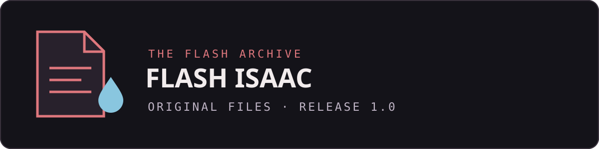

<p align="center">
  
</p>

<p align="center">
  <a href="https://github.com/Arytemu/flash-isaac-original-files/releases/tag/1.0">Скачать релиз 1.0</a>
  · <a href="#каталог-файлов">Каталог файлов</a>
  · <a href="#проверка-загрузки">SHA-256</a>
</p>

# Flash Isaac · Original Files

Неофициальный архив файлов Flash-версии The Binding of Isaac.
На этой странице собраны ссылки на файлы опубликованного релиза `1.0`.

| Релиз | Файлы | Общий размер загрузки |
| :--- | :--- | :--- |
| [1.0](https://github.com/Arytemu/flash-isaac-original-files/releases/tag/1.0) | 18 ZIP-файлов | 3.89 GiB |

Размер указан для загруженных архивов, не для распакованных файлов.

## Скачать

1. Открой [релиз 1.0](https://github.com/Arytemu/flash-isaac-original-files/releases/tag/1.0).
2. Разверни раздел Assets и выбери нужные файлы либо используй ссылки ниже.
3. Сохраняй исходные имена файлов.

Архивы размещены в Releases, а не в Git-дереве. `git clone` и кнопка
Code → Download ZIP скачивают документацию репозитория, но не прикреплённые
к релизу ZIP-файлы с ресурсами.

## Каталог файлов

Названия приведены как в релизе. Содержимое архивов здесь не переупаковывается.

| Файл | Размер |
| :--- | ---: |
| [buttons.zip](https://github.com/Arytemu/flash-isaac-original-files/releases/download/1.0/buttons.zip) | 525.91 KiB |
| [fonts.zip](https://github.com/Arytemu/flash-isaac-original-files/releases/download/1.0/fonts.zip) | 12.83 KiB |
| [frames.zip](https://github.com/Arytemu/flash-isaac-original-files/releases/download/1.0/frames.zip) | 4.55 MiB |
| [images.zip](https://github.com/Arytemu/flash-isaac-original-files/releases/download/1.0/images.zip) | 1.07 MiB |
| [morphshapes.zip](https://github.com/Arytemu/flash-isaac-original-files/releases/download/1.0/morphshapes.zip) | 767 B |
| [scripts.zip](https://github.com/Arytemu/flash-isaac-original-files/releases/download/1.0/scripts.zip) | 445.44 KiB |
| [shapes.zip](https://github.com/Arytemu/flash-isaac-original-files/releases/download/1.0/shapes.zip) | 18.91 MiB |
| [sounds.zip](https://github.com/Arytemu/flash-isaac-original-files/releases/download/1.0/sounds.zip) | 24.84 MiB |
| [sprites1.zip](https://github.com/Arytemu/flash-isaac-original-files/releases/download/1.0/sprites1.zip) | 450.00 MiB |
| [sprites2.zip](https://github.com/Arytemu/flash-isaac-original-files/releases/download/1.0/sprites2.zip) | 450.00 MiB |
| [sprites3.zip](https://github.com/Arytemu/flash-isaac-original-files/releases/download/1.0/sprites3.zip) | 450.00 MiB |
| [sprites4.zip](https://github.com/Arytemu/flash-isaac-original-files/releases/download/1.0/sprites4.zip) | 450.00 MiB |
| [sprites5.zip](https://github.com/Arytemu/flash-isaac-original-files/releases/download/1.0/sprites5.zip) | 450.00 MiB |
| [sprites6.zip](https://github.com/Arytemu/flash-isaac-original-files/releases/download/1.0/sprites6.zip) | 450.00 MiB |
| [sprites7.zip](https://github.com/Arytemu/flash-isaac-original-files/releases/download/1.0/sprites7.zip) | 450.00 MiB |
| [sprites8.zip](https://github.com/Arytemu/flash-isaac-original-files/releases/download/1.0/sprites8.zip) | 450.00 MiB |
| [sprites9.zip](https://github.com/Arytemu/flash-isaac-original-files/releases/download/1.0/sprites9.zip) | 329.76 MiB |
| [texts.zip](https://github.com/Arytemu/flash-isaac-original-files/releases/download/1.0/texts.zip) | 5.68 KiB |

### О файлах sprites

В релизе опубликованы `sprites1.zip`–`sprites9.zip`; первые восемь имеют
размер 450 MiB каждый. Способ упаковки и объединения в описании релиза
не указан. По именам и размерам нельзя подтвердить, независимые это архивы
или части одного набора. Эта инструкция не предлагает их склеивать,
переименовывать или распаковывать в определённом порядке без проверки.

## Проверка загрузки

В [SHA256SUMS](SHA256SUMS) сохранены контрольные суммы из метаданных GitHub
для релиза `1.0`. Для проверки полного скачанного набора помести этот файл
в ту же папку, где находятся все 18 ZIP-файлов, и выполни:

```sh
sha256sum -c SHA256SUMS
```

`OK` означает совпадение с указанной контрольной суммой. Для отсутствующих
файлов команда сообщит об ошибке чтения. Эта проверка не является аудитом
безопасности и не подтверждает происхождение ресурсов из конкретной сборки
игры. Контрольные суммы получены из API GitHub; содержимое архивов при
подготовке этого оформления не скачивалось и не проверялось.

## Вопросы и неточности

Если заметил неверную ссылку или хочешь уточнить состав архива, создай
[Issue](https://github.com/Arytemu/flash-isaac-original-files/issues).
Укажи имя файла и описание проблемы. Не прикладывай личные данные.
Точная версия исходной игры и процедура извлечения в текущем релизе не описаны.

## Статус и права

Это не официальный репозиторий разработчиков The Binding of Isaac.
Он не заявляет связь с ними и не предоставляет лицензию на оригинальные
игровые материалы. Их права остаются у соответствующих правообладателей.
Оформление страницы не меняет условия использования содержимого архивов.
